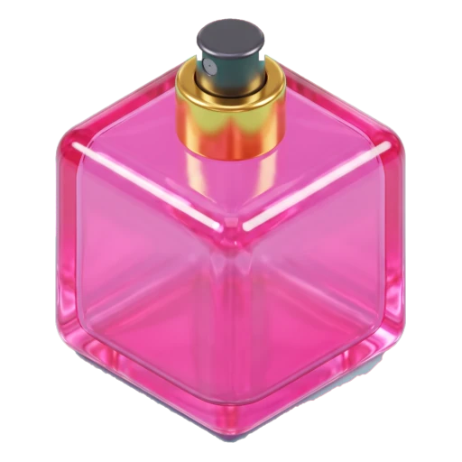
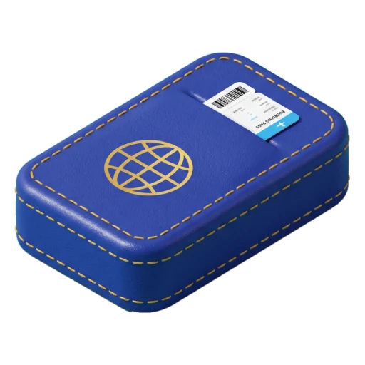
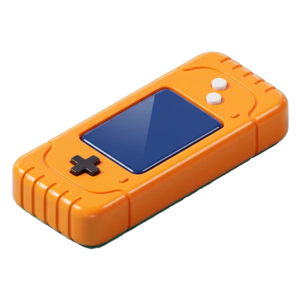
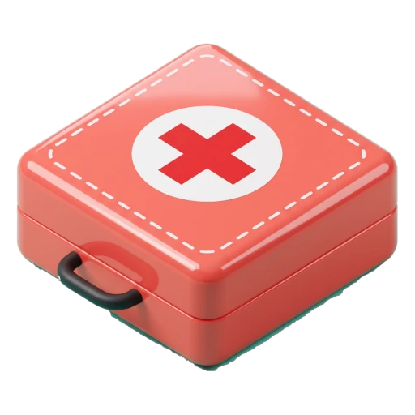
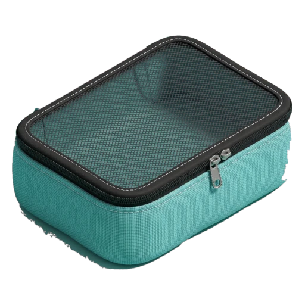
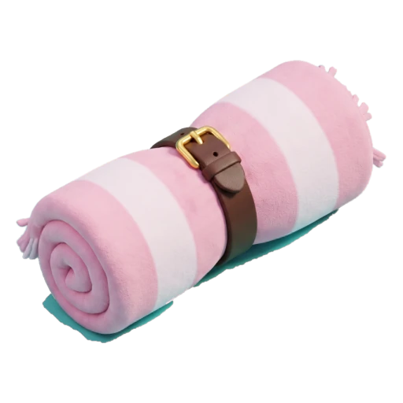
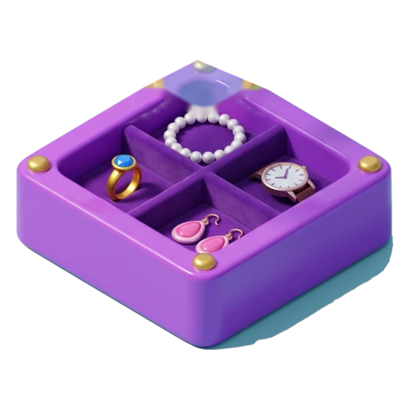
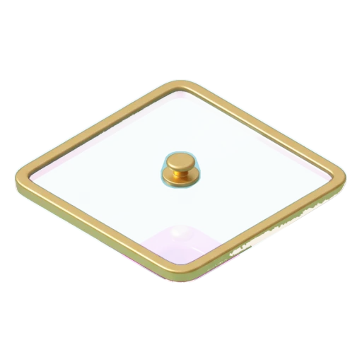
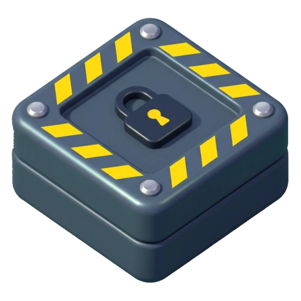

# Pack Jam: Zero Gap

Color Block Jam / Unblock Me görsel diliyle, oynanışı tersine çevrilmiş 3D mobil bulmaca. Kuyrukta bekleyen seyahat eşyalarını bavulun kenar kapılarından içeri itip yerleştiriyorsun. Kuyruk bitince bavul kapanır. Bazı bavullarda boşluk hakkın var, **Zero Gap** bavullarında hiç yok.

Oynamak için `index.html` dosyasını tarayıcıda açman yeterli (Three.js r128, GSAP 3.12.5 ve fontlar CDN'den yüklenir). Ana sayfayı atlayıp belirli bir bölümü açmak için: `index.html?level=45`.

## Eşyalar

| | Eşya | Kod | Boyut | Kural |
| --- | --- | --- | --- | --- |
|  | Parfüm şişesi | `perfume` | 1×1 | Normal blok. Vakum'un ürettiği joker parfüm (altın renkli) ise kapı aramadan herhangi bir boş kareye bırakılır. |
|  | Pasaport cüzdanı | `passport` | 2×1 / 1×2 | Oklu olanlar sadece ok yönünde kayar ve o eksendeki kapılardan girer. |
|  | El oyun konsolu | `console` | 3×1 / 1×3 | Uzun blok. Dar kapıdan sadece uzun yönüyle girer. Oklu olabilir. |
|  | İlk yardım çantası | `kit` | 2×2 | Standart büyük kare. |
|  | Kıyafet organizeri | `organizer` | 3×2 / 2×3 | Büyük hacimli eşya. Oklu olabilir. |
|  | Kemerli plaj havlusu | `towel` | 1×3 → 1×2 | Duvara ya da sert bir eşyaya itmeye devam edince büzüşür. Havlu havluyu sıkıştırmaz. |
|   | Takı kutusu ve şeffaf kapağı | `jewelry`, `lid` | 2×2 | Kutu hiçbir yöne kayamayacak şekilde oturunca kuyruktaki kapağı takılır ve kutu kilitlenir. |
|  | Sabit bölme | `divider` | 1×1 | Hareket etmeyen engel. |

Bavuldaki eşyalar bu tasarımlara göre Three.js'te modellenir; kuyruk tepsisinde ve yardım ekranında tasarımların kendisi (arka planı silinmiş haliyle) gösterilir. Tepsideki küçük kare ızgarası sıradaki eşyanın boyutunu ve yönünü, kesikli kare havlunun büzüşen hücresini gösterir.

### Kontroller

- **Kapıya dokun** ya da sıradaki tepsiyi kapıya sürükle. Kapı tek şeritliyse eşya hemen girer.
- **Geniş kapılar:** Eşyanın girebileceği birden fazla şerit varsa dokunduğunda eşya girmez. Kapı ağzında hayaleti, gideceği yer ve şerit noktaları belirir. Parmağını kapı boyunca kaydırıp bırakınca ya da aynı şeride tekrar dokununca eşya girer. Başka bir şeride dokunmak seçimi oraya taşır, kapı dışına dokunmak iptal eder.
- **Kuyruk:** Bant yatayda kaydırılabilir ve kuyruğun tamamını sırayla gösterir. Sol üstteki **Kuyruk N** düğmesi bütün sırayı eşya adı ve boyutuyla bir listede açar.
- **El ipuçları:** 1, 4, 21, 36 ve 61. bölümlerde yeni bir mekanik açılınca bavulun üstünde yarı saydam bir el kısa bir gösterim yapar: kapıya dokunup şerit seçme (1), eşya kaydırma (4), oklu eşyanın yalnızca ok yönünde kayması (21), havlunun duvara itilip büzüşmesi (36) ve şeffaf kapağın takı kutusuna oturması (61). Oyuncu herhangi bir yere dokununca el kaybolur ve 6 saniye hareketsizlikten sonra geri gelir. Gösterilen hamle bir kez yapılınca bir daha çıkmaz. Yardım ekranındaki "El ipuçlarını yeniden göster" düğmesi hepsini sıfırlar.

### Ana sayfa, yıldızlar ve jetonlar

- Oyun **ana sayfada** açılır: sıradaki bavul 3D olarak döner platformda durur, etiketinde bölüm numarası yazar. **Bölüm N** düğmesi sıradaki bölümü başlatır. Oyun içindeki ev düğmesi ana sayfaya döner.
- Alt menü: **Market** (jetonla yedek booster), **Ana Sayfa**, **Bölümler** (100 bölümün faz faz haritası, kazanılan yıldızlar, açık bölümler tekrar oynanabilir).
- Bavul kapanınca **yıldız ekranı** gelir. Her hedef bir yıldız: bavulu kapat, Vakum ve Silkele kullanma, en fazla `ceil(çözüm adımı × 1,1) + 1` hamle. Ekranda süre, doluluk ve kazanılan jeton görünür. Ekrana dokunmak ana sayfaya döner.
- Jeton: bir bölümü ilk bitirişte 10 + yıldız başına 5. Tekrar oynayınca sadece yeni kazanılan yıldız başına 5.
- **Yıldız sandığı:** her 15 yıldızda açılır, 60 jeton ve sırayla bir yedek booster verir.
- Booster bitince düğmesinde **+** görünür. Dokununca jetonla alma penceresi açılır (Geri Al 30, Silkele 50, Vakum 60). Bölümün kendi hakları bitince yedekler kullanılır.
- İlerleme tarayıcının `localStorage`'ında tutulur (`pj-save-v1`). Ayarlar'dan ses, el ipuçları ve ilerlemeyi sıfırlama yönetilir.

### Booster'lar

| Booster | Etki |
| --- | --- |
| Geri Al | Son hamleyi geri alır. |
| Vakum | Seçilen eşyayı bir boy küçültür; açılan her kare için kuyruğun başına bir joker parfüm ekler. |
| Silkele | Bavulu sallar, tüm eşyaları seçilen yöne presleyip aradaki boşlukları kapatır. |

Hak sayıları faza göre azalır: Faz 1–3'te 5/2/2, Faz 4'te 4/1/2, Faz 5'te 3/1/1.

## Esnek doluluk ve boşluk hakkı

Kuyruktaki eşyaların toplam alanı sabittir, bu yüzden hedef doluluğun altında kalan kareler oyuncunun harcayabileceği bir **boşluk hakkıdır**. Arayüzdeki sayaç `boş kare − kalan kuyruk alanı` ile hesaplanır. Büzüştürülmeyen her havlu hakkından bir kare yer. Boşluklar kapı ağzında ya da dağınık kalırsa büyük eşyalar sığmaz ve "Out of Space!" ekranı gelir.

## 100 bölümlük eğri

| Bölüm | Grid | Doluluk | Yeni |
| --- | --- | --- | --- |
| 1–15 | 5×5 → 6×6 | %100 | Parfüm, pasaport; 4: konsol; 13: ilk dar kapı; 15: Faz 1 sınavı |
| 16–35 | 6×6 | %97 → %89 | 16: ilk boşluk; 18: ilk yardım; 21: oklu pasaport; 24: 3 kapı; 26: sabit bölme; 31: oklu konsol |
| 36–60 | 6×7 | %86 → %74 | 36: plaj havlusu; 39: 2 havlu; 45: havlu sınavı; 51: kümeli boşluklar |
| 61–85 | 7×7 | %80 → %71 | 61: takı kutusu ve kapak; 64: organizer; 71: 2 kutu; 80: kapak ve düşük doluluk sınavı |
| 86–100 | 7×8 | %75 → %70 | Hepsi bir arada; 90, 95 ve 100: Zero Gap (%100) |

Her 10'luk blok testere dişi ilerler: x1–x3 rahat, x7 nefes, x0 zirve. 100. bölümden sonra sonsuz bölümler gelir. Bölüm başına bütün değerler `levels.json` dosyasında.

## Çözülebilirlik garantisi

Her bölüm tersine üretilir ve doğrulanır:

1. İmza eşyalar (takı kutuları, organizerler, havlular) yerleştirilir.
2. Planlı boşluklar seçilir: %88 doluluğun üstünde dağınık, altında kümeli. Hiçbir takı kutusunun bir kenarı tamamen boş kalmaz.
3. Kalan alan seyahat eşyalarıyla eksiksiz döşenir.
4. Eşyalar oyunun kendi kurallarıyla kapılardan dışarı çıkarılır.
5. Çıkarma sırasının tersi oyuncunun kuyruğu olur; şeffaf kapaklar, kutunun kalıcı olarak oturduğu ana yerleştirilir.
6. Referans çözüm, gerçek kuyrukla oyun motorundan baştan sona yeniden oynatılır. Geçemeyen bölüm gösterilmez.

## Geliştirme

```
src/engine.js         kurallar ve tersine üretici
src/levels.js         100 bölümlük eğri: designLevel(n)
src/levels.baked.js   üretilmiş {variant, attempt} tablosu (tools/bake.js yazar)
src/game.js           Three.js sahnesi, kontroller, arayüz
src/page.html         HTML ve CSS
src/icons.js          kuyruk ikonları (tools/make_icons.py yazar)
assets/items/         eşya tasarımlarının arka planı silinmiş halleri (512 px WebP)
tools/bake.js         100 bölümü arar, doğrular, levels.baked.js ve levels.json yazar
tools/cutout.py       eşya render'larını turkuaz stüdyo arka planından keser
tools/make_icons.py   kesimleri assets/items ve src/icons.js olarak kaydeder
tools/build.js        hepsini tek dosya index.html olarak birleştirir
```

Yeni bir eşya görseli geldiğinde (dosya adları `perfume`, `passport`, `console`, `kit`, `organizer`, `towel`, `jewelry`, `divider`; `.jpg`; takı kutusu görseli kapağı da içerir):

```
python3 tools/cutout.py <tasarim_klasoru> <kesim_klasoru>
python3 tools/make_icons.py <kesim_klasoru>
node tools/build.js
```

`src/levels.js` dosyasında bir değeri değiştirdikten sonra:

```
node tools/bake.js        # ya da tek aralık: node tools/bake.js 40 60
node tools/build.js
```

Önceden üretim sayesinde her bölüm oyunda 10 ms'nin altında açılır.
